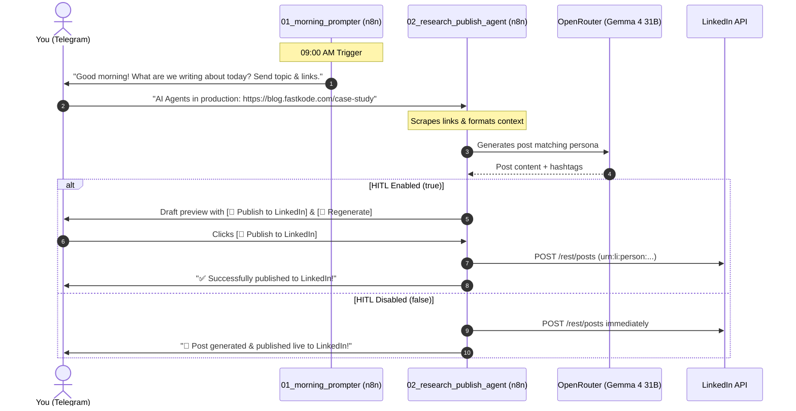

# LinkedIn Daily Post Writer: Setup & Deployment Guide

This automation generates and publishes daily LinkedIn posts tailored to your voice, driven by an interactive Telegram bot, research web scrapers, and OpenRouter AI (`google/gemma-4-31b-it:free`).

---

## 1. Prerequisites & Credentials

### A. Telegram Bot
1. Open Telegram and search for `@BotFather`.
2. Send `/newbot`, name your bot (e.g., `FastKode Sam Writer Bot`), and give it a unique username ending in `bot`.
3. Copy your **Bot API Token** (format: `123456789:ABCdefGHIjklMNOpqrsTUVwxyz`).
4. Start a chat with your newly created bot and click **Start** or send `/start`.
5. Get your personal **Chat ID**:
   - Message `@userinfobot` or `@raw_data_bot` on Telegram to view your numeric user ID (e.g., `987654321`).
6. In n8n, create a **Telegram API** credential using your Bot API Token.

### B. LinkedIn Developer App & Account URN
1. Head to the [LinkedIn Developer Portal](https://www.linkedin.com/developers/apps).
2. Create an App and associate it with your LinkedIn Page.
3. Under **Products**, add:
   - **Share on LinkedIn** (grants `w_member_social`)
   - **Sign In with LinkedIn using OpenID Connect** (for personal profile access)
4. In n8n, add a **LinkedIn OAuth2 API** credential with Client ID & Client Secret from your LinkedIn App.
5. Identify your Author URN:
   - **Personal Profile**: `urn:li:person:YOUR_MEMBER_ID` (Found via `https://api.linkedin.com/v2/userinfo` sub field).
   - **Company / Organization Page**: `urn:li:organization:YOUR_ORGANIZATION_ID` (Found in your LinkedIn Page URL).

### C. OpenRouter AI (Shared Default)
- The workflow uses OpenRouter's OpenAI-compatible endpoint with the high-capability free model: `google/gemma-4-31b-it:free`.
- In n8n, configure an **OpenAI API** credential (or Header Auth):
  - **Base URL**: `https://openrouter.ai/api/v1`
  - **API Key**: `YOUR_OPENROUTER_API_KEY`
- Because this is pre-wired into the workflow template, once saved on your n8n instance, subsequent users cloning this workflow inherit this configuration automatically.

---

## 2. Deploying for a New User / Profile

Follow these steps to spin up an isolated bot for any team member or executive:

1. **Import the Workflows into n8n**:
   - Import `01_morning_prompter.json` (Morning Cron Prompter).
   - Import `02_research_publish_agent.json` (Research, Drafting & Publishing Pipeline).
2. **Assign Credentials**:
   - In `01_morning_prompter.json`: Select the user's Telegram Bot credential.
   - In `02_research_publish_agent.json`: Select the user's Telegram Bot credential, OpenRouter credential, and LinkedIn OAuth2 credential.
3. **Configure User Parameters**:
   - Open the **`Edit Fields (User Config)`** node in `02_research_publish_agent.json` and customize:
     - `CHAT_ID`: The Telegram user ID authorized to command this bot.
     - `ENABLE_HITL`: Set to `true` (Review draft before posting) or `false` (Auto-publish immediately).
     - `LINKEDIN_AUTHOR_URN`: e.g. `urn:li:person:12345678` or `urn:li:organization:87654321`.
     - `POST_AS`: `"person"` or `"organization"`.
     - `PERSONA_SYSTEM_PROMPT`: Copy from `persona.config.json` or customize your personal voice.
4. **Activate Both Workflows**:
   - Toggle both workflows to **Active**.

---

## 3. Daily User Flow

